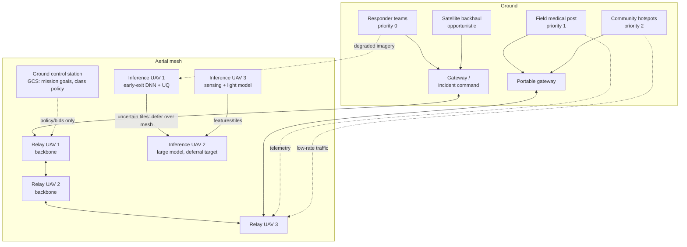

# Direction C — Disaster-Resilient Self-Organizing UAV Edge Mesh

## 1. Title & Abstract

**Title:** *AeroMesh: A Self-Healing Aerial Edge Mesh for Post-Disaster Connectivity and On-Board Damage Assessment*

**Abstract (≈220 words).** In the first hours after an earthquake or flood, terrestrial networks are down exactly when connectivity is most valuable: responders cannot coordinate, field hospitals cannot reach telemedicine, and no imagery reaches decision makers. We propose **AeroMesh**, a fleet of UAVs that self-organizes into an aerial mesh network providing (i) priority-differentiated connectivity for emergency responders, medical teams, and affected communities, and (ii) on-board edge inference for rapid building-damage assessment from degraded imagery — clouds, smoke, low light, motion blur, and packet-corrupted tiles. Our core claim is that connectivity restoration and damage assessment should be *co-designed*, not stacked: which UAV hovers as a relay and which flies a sensing pattern as an inference node is a joint decision that must be re-solved continuously as UAVs exhaust batteries and imagery quality fluctuates. We formalize this as a stochastic online optimization — joint mesh formation and task placement under a time-varying node-failure process — and solve it with three decentralized loops: gossip-based mesh formation with connectivity-maintenance control, a combinatorial auction for relay/inference role assignment, and uncertainty-aware early-exit inference that degrades gracefully and defers ambiguous tiles over the mesh. We evaluate in a co-simulator coupling UAV dynamics, degraded air-to-ground channels, and a corruption pipeline over public disaster imagery (xBD, CrisisMMD, AIDER, FloodNet). Target venues: MobiSys/MobiCom, INFOCOM; alternate venue: IEEE Internet of Things Journal.

---

## 2. Motivation & Problem Statement

### 2.1 The operational gap

Post-disaster communication failure is well documented: terrestrial backhaul and power fail precisely where and when demand spikes. Emergency-network prototypes such as the Wi-Fi-on-drone "WiND" chain network [TODO: full author list — "Design and Deployment of UAV-Aided Post-Disaster Emergency Network," IEEE Access, 2019] demonstrated that a handful of UAVs carrying commodity Wi-Fi radios can restore multi-hop connectivity over hundreds of meters per hop. UAV-mounted base stations are now an established tool for temporary coverage [Mozaffari et al., 2016; Mozaffari et al., 2019], and throughput management for UAV small cells in disaster areas has been formulated as a scheduling problem with battery and backhaul constraints [Chiaraviglio et al., 2019]. Meanwhile, computer vision for humanitarian assistance and disaster relief (HADR) matured on satellite data — xBD [Gupta et al., 2019] — and on aerial imagery [Kyrkou & Theocharides, 2020; Rahnemoonfar et al., 2021].

These two threads have, however, been developed almost entirely in isolation:

- **The networking thread assumes the application is a bit pipe.** UAV placement and relay-routing work [Mozaffari et al., 2016; Chiaraviglio et al., 2019; Yanmaz et al., 2011; Tardioli et al., 2024] maximizes throughput, coverage area, or packet delivery, but does not model the fact that in a disaster the *content* flowing over the mesh (imagery, situation reports) has asymmetric value and asymmetric tolerability to delay and error — a responder's push-to-talk flow and a 30 MB image tile are not interchangeable, and a silently wrong damage label is worse than a missing label.
- **The vision thread assumes perfect connectivity and perfect imagery.** Damage-assessment models [Gupta et al., 2019; Xu et al., 2020] are evaluated on clean, complete, centrally processed inputs. On a UAV in smoke at dusk with a lossy radio link, inputs are *corrupted and incomplete*, and the compute-and-communicate budget is a first-class constraint. Robustness-to-corruption studies for generic vision [Hendrycks & Dietterich, 2019] have not been carried into disaster imagery where the corrupted label may drive a resource-allocation decision.

Real deployments additionally bind the design with constraints that most simulation work ignores: (a) UAVs deplete batteries on the order of 20–40 minutes under hovering plus transmit plus compute loads [Mozaffari et al., 2019; Zeng et al., 2019], so the network *must* self-heal through a sequence of failures rather than survive one; (b) responders, medical units, and the public have legally and operationally different service classes; (c) airspace and spectrum are contested and regulated (§5); (d) no cloud is reachable, so all inference happens on <15–100 W on-board compute.

### 2.2 Formal problem statement

**Setting.** Let $V=\{1,\dots,n\}$ be UAVs and $\Gamma$ a set of $\gamma$ ground gateway nodes (portable stations at incident command and field hospitals) with residual terrestrial or satellite backhaul. Each UAV $i$ has a role $c_i \in \{\mathsf{R}, \mathsf{I}\}$ (relay vs. inference node; hybrid roles allowed as $\mathsf{RI}$). Ground demand nodes $D$ (responder teams, medical posts, community hotspots) generate flows with priority class $\pi(d) \in \Pi = \{0,1,2\}$ (responder $>$ medical $>$ civilian), class weights $w=(10,3,1)$, rate demands $r_d$, and deadlines $\delta_{\pi(d)}$. Time is slotted with slot length $\Delta$ over a mission horizon $T$.

**Node failure process.** Each UAV $i$ has battery $B_i$ and, at slot $t$, a hazard

$$
\Pr\!\left(\text{$i$ lost in } (t, t+\Delta]\right) = 1 - \exp\!\left(-\int_t^{t+\Delta}\!\!\lambda_i(u)\,du\right),
$$

where $\lambda_i(u) = \lambda^{\mathrm{env}}_i(u) + \lambda^{\mathrm{bat}}_i(u)$ combines environmental hazards (jamming, wind, weather) and an endogenous battery term that increases as residual energy $E_i(t)$ approaches the reserve needed to return to base. This makes the failure process *endogenous*: placing a UAV as a heavily loaded inference node or at the mesh fringe shortens its lifetime, coupling placement to topology survival.

**Connectivity model.** Let $G(t) = (V(t)\cup D \cup \Gamma,\; E(t))$ with an air-to-ground and inter-UAV link if the achievable rate $R_{ij}(x_i,x_j)$ exceeds a service floor; we use the standard LoS-probability elevation model for the A2G component [Al-Hourani et al., 2014; Mozaffari et al., 2019]. Mesh health is captured by algebraic connectivity $\lambda_2(L(t))$ of the graph Laplacian [Fiedler, 1973], plus a stricter requirement of 2-edge-connectivity between every responder-class demand node and some gateway.

**Service objective.** Let $s_d(t) \in [0,1]$ be the fraction of $d$'s demand delivered within its deadline at slot $t$, given the routing $f(t)$ on $G(t)$. Restored priority-weighted service is

$$
\Phi(t) \;=\; \sum_{d\in D} w_{\pi(d)}\, s_d(t) \Big/ \sum_{d\in D} w_{\pi(d)} .
$$

**Assessment objective.** Let $\mathcal{M}(t)$ be image tiles of the disaster footprint available to the fleet at slot $t$. Assigning tile $m$ to inference-capable UAV $i$ with early-exit depth $e$ and selective threshold $\tau$ yields processed value $\kappa(m,e)$ (assessment quality; §4.3) at compute energy $g(e)$, plus communication energy for fetching the (possibly corrupted) tile and pushing the result. Priority-weighted assessment value is $\Psi(t) = \sum_{m \in \mathcal{M}(t)} w_{\pi(m)} \kappa(m, e_m) \,\mathbb{1}[\text{delivered}]$.

**The joint problem.**

$$
\max_{\{c_i(\cdot),\,x_i(\cdot),\,f(\cdot),\,e(\cdot),\,\tau(\cdot)\}}\;
\mathbb{E}\left[\sum_{t=0}^{T} \gamma^{t}\big(\Phi(t) + \eta\, \Psi(t)\big)\right]
$$

subject to: (i) energy budgets $\sum_t \Delta\,(P_{\mathrm{hov}}(i) + P_{\mathrm{tx}}(i,t) + P_{\mathrm{cmp}}(i,t)) \le B_i$; (ii) mesh connectivity $\lambda_2(L(t)) \ge \epsilon$ and responder-class 2-edge-connectivity; (iii) per-flow deadline and rate feasibility on $f(t)$; (iv) queue stability at inference nodes; (v) selective risk $R(\phi) \le \alpha$ at coverage $\phi$ for the damage classifier; (vi) airspace de-confliction. The expectation is over the failure process, weather and channel dynamics, and the arrival of degraded imagery.

This is a stochastic online joint **connected-facility-location + relay-placement + scheduling** problem: even the static, deterministic subproblem — choose UAV positions so that a set of ground nodes is connected through relays to gateways — generalizes the Steiner tree / connected facility location family and is NP-hard; the dynamic version with endogenous failure rates and coupling to an inference objective is, to our knowledge, unaddressed [TODO: citation for exact hardness reduction; we will formalize via reduction from connected facility location]. Decentralized solution is forced by the setting: after the disaster there is no infrastructure to collect global state at the timescale of failures.

### 2.3 Why prior work is insufficient

1. **Placement work is open-loop w.r.t. failures.** Coverage-maximizing deployment [Mozaffari et al., 2016], MILP-based energy-efficient deployment and routing for disaster response [2024 EEUDR line of work, see §8], and maximum-throughput UAV scheduling [Chiaraviglio et al., 2019] optimize a snapshot or a pre-planned mission; they do not re-solve roles and positions as UAVs die mid-mission, and they place no value on *what* is transmitted.
2. **FANET routing does not move nodes.** Self-healing in FANETs means re-routing: AODV local route repair with greedy geographic forwarding [Biomo et al., 2014; Khan et al., 2020; Arafat & Moh, 2019]. Route repair on a topology that is losing nodes every few minutes converges to nothing to repair. Multi-robot connectivity *maintenance* control [Li et al., 2023; Capelli & Sabattini, 2022; Pan et al., 2024] keeps a fleet connected but has no notion of demand classes, deadlines, or an inference workload competing for the same nodes.
3. **Edge-inference work ignores the network.** Early-exit inference saves energy on-device [Teerapittayanon et al., 2016] and selective classification guarantees risk-coverage trade-offs [Geifman & El-Yaniv, 2017; Geifman & El-Yaniv, 2019], and lightweight UQ is feasible on embedded devices [Gupta et al., 2023 (UQ survey)] — but none of this work treats *which device* runs *which* input as a network decision, nor uses uncertainty as a signal to shape traffic.
4. **Nobody couples the two.** The closest systems work connects UAV swarms to realistic radios [Tardioli et al., 2024; Sánchez et al. (ArduSim), 2018] or couples UAV computing with relaying [2020 combinatorial-bandit UAV edge computing line, §8], but treats sensing targets as given and assumes benign imagery. The gap AeroMesh fills: a single decentralized control system in which connectivity, energy, and inference quality are one objective under an endogenous failure process.

---

## 3. Related Work

### 3.1 FANET formation and routing

FANET research has catalogued proactive, reactive, and hybrid routing derived from MANET protocols [Bekmezci et al., 2013; Lakew et al., 2020; Khan et al., 2020; Arafat & Moh, 2019]. Empirical ns-3 studies consistently find AODV strongest on packet-delivery ratio under high mobility and OLSR strongest on delay, with degradation as node density and speed grow [2023 Drones routing study; 2024 ETCM study, §8]. Route repair exists (AODV local repair, geographic forwarding [Biomo et al., 2014]) but repairs routes, not the *fleet*: when a relay UAV dies, its route is repaired through neighbors whose positions are fixed by their own missions. *Unlike this line, AeroMesh treats the UAV positions themselves as the repaired quantity*: on node loss the fleet repositions idle capacity to restore the backbone, and routing adapts over the repositioned topology.

### 3.2 UAV placement and networked coverage control

Drone small cells and 3D placement [Mozaffari et al., 2016; Mozaffari et al., 2019], cellular-connected UAVs [Zeng et al., 2019], UAV relay and MEC energy trade-offs [Zeng et al., 2019 (MEC)], and throughput management in disasters [Chiaraviglio et al., 2019] treat placement as (mostly centralized) optimization. Networked-robotics coverage control brings it online: distributed coverage via Lloyd-type dynamics and distributed submodular partitioning [Liu et al., 2024], coverage path planning surveys [Cabreira et al., 2019; Sun et al., 2025], connectivity-aware decentralized relay placement validated on real hardware [Tardioli et al., 2024], and path planning for networked UAVs [Yanmaz et al., 2011]. *Unlike all of these, AeroMesh optimizes coverage jointly with a heterogeneous role split (relay vs. inference) and an endogenous failure process; a placement that maximizes coverage today can destroy the mesh tomorrow by depleting the batteries of the nodes that carry the backbone.*

### 3.3 Connectivity maintenance and self-healing multi-robot systems

Control-theoretic connectivity maintenance keeps $\lambda_2(L)$ above a threshold via CBFs [Capelli & Sabattini, 2022], extends to effective-resistance objectives robust to adversarial neighbors [Pan et al., 2024], and to self-healing under realistic CSMA/CA media access [Li et al., 2023]. Gossip algorithms give the decentralized primitives (averaging, consensus) we build on [Dimakis et al., 2010]. *Unlike this line, which maintains connectivity of a fleet that exists to move or sense, AeroMesh maintains a service: connectivity is weighted by demand priority and deadlines, and the fleet trades connectivity against an inference workload sharing the same energy budget.*

### 3.4 Edge inference under uncertainty and corrupted inputs

Early exiting via side branches cuts compute by 2–5× with entropy-based exits [Teerapittayanon et al., 2016]; slimmable networks give width-adaptive execution [Yu et al., 2019]; selective classification adds a reject option with risk-coverage guarantees [Geifman & El-Yaniv, 2017; Geifman & El-Yaniv, 2019]; uncertainty comes from MC dropout [Gal & Ghahramani, 2016], deep ensembles [Lakshminarayanan et al., 2017], and conformal prediction [Angelopoulos & Bates, 2021], with hardware-constrained comparisons surveyed in [Gupta et al., 2023 (UQ survey)]. Corruption robustness benchmarks (CIFAR-C/ImageNet-C) show corruption-aware training transfers across corruption types [Hendrycks & Dietterich, 2019]. *Unlike this line, which assumes the input arrives intact and the compute budget is static, AeroMesh (i) benchmarks disaster models under a physically motivated corruption pipeline (smoke, fog, low light, tile loss, compression on the radio), and (ii) treats model uncertainty as a routing signal — ambiguous tiles are deferred to a better-sited inference UAV over the mesh when the marginal communication cost beats the marginal accuracy value.*

### 3.5 Disaster imagery and emergency datasets

xBD provides 850k+ building annotations with 4-level damage labels across 19 disasters [Gupta et al., 2019], with strong two-stage localization+classification solutions from the xView2 challenge [Xu et al., 2020, §8]. Aerial alternatives include AIDER/EmergencyNet [Kyrkou & Theocharides, 2020], FloodNet [Rahnemoonfar et al., 2021], RescueNet [TODO: citation — RescueNet, arXiv:2202.12361], SEN12FLOOD [Rüßwurm et al., 2020], and the multimodal CrisisMMD [Alam et al., 2018]. *Unlike prior uses of these datasets (offline, cloud-side evaluation), we use them as the substrate of an online system: tiles arrive through the mesh, corrupted, at a rate set by the network.*

---

## 4. Method Design

### 4.1 System overview



Three decentralized loops run at different timescales:

1. **Topology loop (1 Hz):** gossip-based mesh formation and connectivity-maintenance mobility (§4.2, Alg. 1).
2. **Placement loop (epoch $\Delta_e = 30$ s):** combinatorial auction deciding relay/inference roles and task-to-UAV assignment (§4.3, Alg. 2).
3. **Inference loop (per tile):** early-exit, uncertainty-aware, selectively deferred inference (§4.4).

*Intuition per design choice: separating the loops by timescale lets fast loop use slow loop's decisions as constants, so no loop needs global state.*

### 4.2 Decentralized mesh formation and self-healing

Each UAV maintains a $k$-hop local view $G_i^k(t)$ built from beacons (HELLO with position, role, residual energy, queue length — 20 B payload at 1 Hz). On $G_i^k$, each UAV runs a decentralized power iteration to estimate its local algebraic-connectivity contribution $\hat{\lambda}_{2,i}$ over the 2-hop induced subgraph [Fiedler, 1973; Dimakis et al., 2010], and a local CBF-style constraint keeps the fleet's connectivity above $\epsilon$ without computing global $\lambda_2$ [Capelli & Sabattini, 2022; Pan et al., 2024].

Mobility control per UAV:

$$
\dot{x}_i = \alpha_1 \nabla U_{\mathrm{cov}}(x_i) + \alpha_2 \nabla U_{\mathrm{conn}}(x_i) - \alpha_3 \nabla U_{\mathrm{energy}}(x_i) + u_i^{\mathrm{CBF}},
$$

where $U_{\mathrm{cov}}$ is a Lloyd-style centroid attraction to its assigned demand cluster [Liu et al., 2024; Cabreira et al., 2019], $U_{\mathrm{conn}}$ is the negative-gradient of local effective resistance to its two gateway paths, $U_{\mathrm{energy}}$ penalizes positions requiring sustained max transmit power, and $u_i^{\mathrm{CBF}}$ enforces $\hat{\lambda}_{2,i} \ge \epsilon$ as a hard barrier.

**Self-healing.** On beacon loss, the detecting UAV declares candidate failure after $T_{\mathrm{dead}}$ slots (0.3 s), confirms via 2-hop gossip, and the *least-loaded neighbor* executes a three-option repair in order of cost: (a) reroute locally (if an alternate path exists within 2 hops); (b) promote the nearest idle or lightly loaded inference UAV to relay (role change); (c) reposition: candidate $j$ among 2-hop neighbors moves to the barycenter that minimizes the increase in effective resistance between the disconnected demand node and its gateway. Repairs are recorded in a gossip-consistent role table so that repairs compose without a leader.

```text
Algorithm 1  GOSSIP-MESH (per UAV i, every beacon slot)
Input: local view G_i^k, role c_i, residual energy E_i, class policy w
 1: broadcast HELLO{pos_i, c_i, E_i, queue_i, epoch}
 2: update G_i^k from received HELLOs; mark links with SNR < beta as dead
 3: for each lost neighbor j:  // self-healing trigger
 4:     T_lost(j) += 1;  if T_lost(j) < T_dead: continue
 5:     if exists 2-hop alternate path to my gateways: reroute        // (a) cheap
 6:     else if I am the least-loaded 2-hop neighbor:
 7:         promote: c_i <- R; reserve P_hov margin; announce role    // (b)
 8:     else elect nearest low-load neighbor j* to reposition:
 9:         x* <- argmin_x [R_eff(G_i^k union x) to gateway paths]    // (c)
10:         send REPAIR{x*} to j*  (lease T_lease, revocable)
11: run 1 step of power iteration for lambda-hat_{2,i} on G_i^k
12: x_i <- x_i + [alpha_1*grad U_cov + alpha_2*grad U_conn
                  - alpha_3*grad U_energy]*delta_t + CBF(u)
13: if E_i < E_reserve: switch to RETURN-TO-BASE, demote role,
    broadcast DEPART so neighbors pre-emptively heal (Alg. 1 line 5-9)
```

*Intuition: repairs are chosen by marginal cost (reroute < promote < reposition) and leases are revocable, so the fleet heals from many near-simultaneous failures without oscillation.*

### 4.3 Priority-aware service differentiation and auction-based placement

**Service differentiation.** Class $\pi$ gets a deadline $\delta_\pi$ and a guaranteed share $\alpha_\pi$ of each link's service floor (responder 0.5, medical 0.3, civilian 0.2), enforced by weighted fair queuing at each UAV with class weights $w_\pi$, plus EDCA-style channel-access differentiation on the 802.11 radio. $s_d(t)$ counts only in-deadline delivery, so the objective itself prioritizes, and $\alpha_\pi$ guarantees civilians are not starved (a deliberate humanitarian constraint: situational awareness from communities feeds the response).

**Placement as a submodular assignment.** In each epoch, the fleet re-solves: which UAVs are relays vs. inference nodes, which demand clusters each relay serves, and which image tiles each inference UAV fetches and processes. Define the marginal value of UAV $i$ taking tile set $S_m$:

$$
\Delta(i, S) = \sum_{m \in S} w_{\pi(m)}\, \kappa(m, e_i) \;-\; C_{\mathrm{fetch}}(i, S) \;-\; C_{\mathrm{energy}}(i, S, \rho_i),
$$

where $\kappa(m,e)$ is the corruption-aware expected accuracy value of processing tile $m$ to exit depth $e$ (§4.4), $C_{\mathrm{fetch}}$ prices fetching the tile over the mesh from its source, and $C_{\mathrm{energy}}$ prices compute + hover + transmit, including the induced hazard increase $\lambda^{\mathrm{bat}}_i$ from extra drain. Queueing makes $\Delta$ monotonically decreasing in $|S|$ per UAV (diminishing returns), i.e., submodular in tiles per node — so greedy assignment on the submodular objective is a principled $(1-1/e)$-approximation centrally, and we implement it as a **decentralized sequential combinatorial auction** [Bertsekas, 1988; Dimakis et al., 2010]:

```text
Algorithm 2  PRIORITY-AUCTION (per epoch, decentralized)
Input: bids B (one per mission/tile-bundle, with class pi and deadline),
       UAV cost estimates c_i, role table from Alg. 1
 1: each mission manager m forms bid b_m = w_pi(m) * v_hat(m) - deadline penalty
 2: each inference UAV i posts ask a_i(S) = C_fetch + C_energy for bundles S
 3: rounds r = 1..R:
 4:   each demand node sends its bid to its nearest k inference UAVs only
 5:   UAV i computes greedy set S*_i = argmax_S (b(S) - a_i(S)) over received
      bundles (size-capped: |S| <= L_i by queue and energy)
 6:   conflict resolution: among UAVs bidding for the same bundle, lowest
      composite (cost, distance, queue) wins; losers decrement bid and retry
 7:   winners announce assignments via mesh gossip; losers update costs
 8: relays re-balance: if any responder-class flow lost its path in the last
    epoch, force one relay promotion before any inference award  (safety rule)
 9: commit role table; unassigned capacity defaults to relay duty
```

*Intuition: the safety rule (line 8) makes connectivity lexicographically prior to inference value, so the coupled objective degrades gracefully — assessment throughput is traded away before responder connectivity.*

**Complexity.** Per UAV per beacon slot: $O(d \log d + d\,k)$ for $k$-hop graph maintenance with degree $d$ (bounded by channel: $d \le \bar d$, so effectively $O(\bar d \log \bar d)$); power-iteration step $O(\bar d^2)$ on the 2-hop Laplacian (dense $\bar d \times \bar d$ local matrix, $\bar d \le 12$ in practice). Messages: $O(\bar d)$ per slot, $O(1)$ payload each; network-wide $O(n \bar d)$ per slot versus $O(n^3)$ for centralized $\lambda_2$ computation or SDP-based placement. Auction: $O(n_{\mathsf I} \log n_{\mathsf I} + B k)$ per epoch with $n_{\mathsf I}$ inference UAVs, bundle size cap $L$. Memory per UAV: $O(\bar d^2)$ for the local Laplacian plus the role table $O(n)$. All primitives (averaging, min-selection, election) are gossip-friendly [Dimakis et al., 2010]; the design point is that **no component requires more than 2-hop state**, which is what survives partitions.

### 4.4 Uncertainty-aware, early-exit damage assessment on-board

**Model.** Per-inference-UAV cascade: a lightweight backbone (ResNet-18/U-Net style, xBD two-stage localization + ordinal damage classification following the challenge setting [Gupta et al., 2019; Xu et al., 2020]) with early-exit heads at 3 depths [Teerapittayanon et al., 2016]; the largest inference UAV additionally hosts a heavier model serving deferred tiles. Uncertainty at each exit: entropy of the softmax (free) plus a 2-head mini-ensemble or MC-dropout with $S{=}4$ passes on-demand [Gal & Ghahramani, 2016; Lakshminarayanan et al., 2017], calibrated by split-conformal thresholds on a held-out calibration set [Angelopoulos & Bates, 2021].

**Corruption pipeline.** Each tile is corrupted before it reaches the model with a physically motivated mix: weather (fog, smoke overlay, rain streaks, snow), photometric (low light, overexposure), geometric (motion blur, hover jitter), and *channel* corruptions (tile loss, block corruption from packet loss, JPEG re-encoding at reduced rate) — parameterized in the style of CIFAR-C/ImageNet-C severity levels [Hendrycks & Dietterich, 2019] but grounded in the environmental-factor labels available in xBD (smoke, water, fire) [Gupta et al., 2019].

**Selective early-exit policy.** Per tile: run to exit $e$; if conformal set size $|\mathcal{C}(m)| \le q$ and entropy below $\tau_e$, emit and exit; else either (i) escalate compute locally (next exit, ensemble passes) or (ii) **defer over the mesh** to the better-sited inference UAV if the marginal value of the accuracy gain exceeds the marginal communication cost:

$$
\text{defer} \iff w_{\pi(m)}\big[\kappa_{\mathrm{big}} - \kappa_e\big] > C_{\mathrm{defer}}(i \to j) + \eta_{\mathrm{energy}}\, g_{\mathrm{defer}} .
$$

Deferral is the concrete coupling between the network and the model: uncertainty estimates shape traffic, and mesh congestion prices accuracy.

**Selective risk-coverage objective.** Let $\phi$ be coverage (fraction of tiles accepted) and $R(\phi)$ the selective risk. We operate at a target risk $\alpha$ (e.g., $R \le 0.05$ macro on the 4-level damage scale) and report the risk-coverage curve; priority-weighted tile selection means high-value tiles consume scarce heavy-compute budget [Geifman & El-Yaniv, 2017; Geifman & El-Yaniv, 2019].

**Graceful degradation.** When inference nodes saturate or die, the cascade automatically (a) lowers default exit depth, (b) narrows the deferral budget, (c) narrows coverage (more rejected tiles, held for later or marked unassessed) — the system trades assessment *recall* for *precision* rather than emitting wrong labels, which is the operationally correct failure mode.

### 4.5 Simulation compute cost [ESTIMATED]

| Component | Cost (per unit) | Basis of estimate |
|---|---|---|
| Co-simulation step (mobility + channel + mesh, $n{=}100$, 10 Hz) | 0.3–1.2 CPU-core-s / sim-second | event-driven graph ops, $\bar d \approx 10$ |
| Full mission run (1 h sim) | 0.5–2 CPU-core-h | linear in $n \cdot T$ |
| AODV/OLSR cross-check in ns-3 | 2–5 CPU-core-h / run | ns-3 event overhead is the multiplier |
| xBD model training (U-Net + ResNet-18, 512-px chips) | 12–30 GPU-h (1×A100) | ~110k train tiles, 30–50 epochs |
| Corruption evaluation (15 types × 5 severities × 3 variants) | 4–8 GPU-h | per-tile forward passes, cached features |
| Conformal calibration | <0.1 GPU-h | split calibration only |
| **Full campaign** (30 scenarios × 5 seeds × ~25 configs) | ≈ 4,000–10,000 CPU-core-h + ≈ 100 GPU-h | 64-core cluster + 2 GPUs ≈ 4–8 days wall-clock |

**Sensitivity note.** Cost scales linearly in $n$, $T$, and beacon rate; the dominant term is network simulation steps, and the second is the corruption matrix. If compute is constrained, we cut scenario count to 10 per seed (keeping 5 seeds) before cutting seeds, because seed variance dominates config effects in preliminary sizing; the corruption grid can be cached per (model, severity) and reused across all network configurations since inference results are independent of mesh dynamics.

---

## 5. Limitations & Risks

| Risk | Why it matters | Mitigation |
|---|---|---|
| **Regulatory / airspace** | BVLOS flight over disaster zones needs waivers; urban canyons and no-fly zones (airports, hazmat) constrain placements | Model no-fly zones as first-class constraints in placement; scenario generator includes NOTAM-style exclusion zones; document waiver pathways (public-safety COAs); keep GCS-in-the-loop authorization semantics |
| **Adversarial / extreme weather** | Rain fade, wind exceeding hover authority, sandstorms invalidate the LoS channel model and can ground the fleet | Weather process in simulation; wind-aware feasible-hover envelope; graceful demotion to fewer, closer-spaced relays; treat weather time series as scenario features, not noise |
| **Sim-to-real gap** | Decentralized loops validated in co-simulation may not survive real radios (CSMA/CA capture, GPS denial), as connectivity-control work has had to confront [Li et al., 2023; Tardioli et al., 2024] | Design all primitives to degrade with realistic MAC; ArduSim/OMNeT++ trace coupling [Sánchez et al. (ArduSim), 2018]; small-scale hardware-in-the-loop stretch goal (3–5 drones, Wi-Fi ad-hoc, Raspberry Pi payload — the WiND-class setup [2019 WiND, §8]) |
| **Dataset bias in damage assessment** | xBD is satellite, pre/post pairs, mostly US/caribbean events; aerial oblique UAV imagery differs radically; ordinal labels are noisy; performance drops under geographic/temporal shift are documented (≈0.07 F1) in prior studies | Evaluate cross-disaster and cross-dataset transfer explicitly (§13); report per-disaster-type breakdowns; use aerial datasets (AIDER, FloodNet, RescueNet) as the primary deployment-relevant domain and xBD as scale; calibrate per-domain conformal sets rather than global |
| **Uncertainty calibration drift** | Conformal guarantees weaken under distribution shift exactly when imagery is corrupted | Recalibrate online on a rolling window of confident labels; report conditional coverage by corruption type (§11); ensemble disagreement as a shift alarm [Lakshminarayanan et al., 2017] |
| **Security** | Jamming and GPS spoofing are realistic in disaster airspace | Jamming scenarios (§11); robustness via multi-path routing and deferral; explicit non-goal: cryptographic hardening |
| **Human factors** | Priority weights $w=(10,3,1)$ are a policy choice | Sensitivity analysis over weight vectors; make the policy externally configurable by an incident commander (GCS), not baked in |

---

## 6. Task Definition

Two coupled tasks, evaluated jointly and separately.

**Task A — Connectivity restoration (online).**
- *Input:* at $t_0$, disaster footprint $F$ (damaged regions, disabled infrastructure), ground demand set $D$ with classes and demands $\{(\pi(d), r_d, \delta_{\pi(d)})\}$, gateways $\Gamma$, fleet initial state $\{x_i(0), E_i(0), B_i\}$, failure process $\lambda$, weather and channel dynamics.
- *Output (per slot):* roles $c(t)$, positions $x(t)$, routing/forwarding decisions $f(t)$; over the mission, the trajectory of the restored-service process $\Phi(t)$.
- *Criteria (primary):* priority-weighted restored connectivity $\Phi$ (area under the curve over the mission, and value at $T$); **time-to-restore** per class ($T_{90}^{\pi}$ = time until class-$\pi$ demand reaches 90% of its in-deadline target, held for 5 consecutive minutes); responder-subgraph 2-edge-connectivity uptime.
- *Criteria (secondary):* energy fairness (Jain index of residual energy), control-message overhead, mesh partitions per hour, lifetime of the backbone.

**Task B — Degraded-imagery damage assessment (online, edge).**
- *Input:* stream of tiles from the footprint, each with a corruption state $(\text{type}, \text{severity})$ and a channel loss pattern; a per-tile priority class $\pi(m)$.
- *Output:* per-tile damage prediction with a 4-level ordinal label, a conformal prediction set $\mathcal{C}(m)$, a coverage decision (emit / escalate / defer / reject), and exit depth $e$.
- *Criteria (primary):* macro-F1 over damage classes **under corruption at the deployed operating point**; risk at 90% coverage $R(\phi{=}0.9)$; risk-coverage AUC.
- *Criteria (secondary):* energy per processed tile (J), tiles/hour per UAV, deferral rate and deferral cost/benefit ratio, calibration (empirical coverage vs. target).

**Joint criterion.** The headline metric is a *Pareto frontier* of (priority-weighted restored connectivity, priority-weighted assessment value $\Psi$) under a fixed fleet and energy budget, with the safety rule of §4.3 enforcing lexicographic priority of connectivity.

---

## 7. Benchmark Survey

| Benchmark | Size | Task | Metrics | Used by |
|---|---|---|---|---|
| **xBD / xView2** [Gupta et al., 2019] | 850,736 building polygons, 19 disasters, 15 countries; 1,866 test image chips | Building localization + 4-level damage classification (pre/post pairs) | Binary damaged F1 (with localization), 4-class F1 | xView2 challenge teams [Xu et al., 2020], TorchGeo baselines, corruption-shift studies |
| **CrisisMMD** [Alam et al., 2018] | 16,097 tweets / 18,126 images, 7 disasters (2017); 3,526 images w/ damage-severity labels | Informativeness, humanitarian categories, damage severity (severe/mild/little-none) | Accuracy, macro-F1 per task | Multimodal crisis baselines; our prioritization metadata source |
| **AIDER / EmergencyNet** [Kyrkou & Theocharides, 2020] | 2,545 aerial images, 5 classes (flood, fire/smoke, rubble, accidents, normal); AIDERv2: 16,723 images | Aerial emergency scene classification | Accuracy, F1, latency on Jetson-class hardware | On-board emergency monitoring; our on-device baseline host |
| **FloodNet** [Rahnemoonfar et al., 2021] | 2,343 post-Harvey UAV images (4000×3000), 9 classes | Semantic segmentation, classification, VQA | mIoU, accuracy, VQA accuracy | Flood segmentation baselines |
| **RescueNet** [TODO: citation — arXiv:2202.12361] | 4,494 post-Michael UAV images, 10 classes + building damage severity + road-blockage | UAV semantic segmentation, damage severity | mIoU, per-class F1 | UAV damage segmentation |
| **SEN12FLOOD** [Rüßwurm et al., 2020] | Sentinel-1/2 patches, 190 flood events, 13,010 tiles | Flood detection, segmentation | IoU, F1 | SAR/optical flood mapping; cross-sensor transfer probe |
| **ns-3** [Riley & Henderson, 2010] | discrete-event network simulator (AODV RFC 3561, OLSR RFC 3626, 802.11) | FANET routing/protocol evaluation | PDR, delay, throughput, overhead | Routing protocol studies [2023 Drones; 2024 ETCM, §8] |
| **OMNeT++** [Varga, 2001] | discrete-event simulation framework (INET) | Wireless mesh / UAV network simulation | PDR, delay, connectivity | FANET protocol comparisons |
| **ArduSim** [Sánchez et al. (ArduSim), 2018] | real-time multi-UAV flight + ad-hoc Wi-Fi simulation; exports ns-2/ns-3 and OMNeT++ traces | Swarm mission dynamics + network coupling | Mission completion, link quality | Multi-UAV swarm protocol validation; our UAV dynamics source |

Only real, publicly available benchmarks are listed. Note the deliberate pairing: imagery benchmarks supply Task B ground truth; simulators supply Task A dynamics; the corruption pipeline supplies the coupling.

---

## 8. Baseline Survey

| Method | Year | Venue | Key result | Code? |
|---|---|---|---|---|
| Static center-placement of UAV BSs (greedy/circle coverage) [Mozaffari et al., 2016] | 2016 | IEEE Commun. Lett. | Optimal altitude/horizontal placement maximizes ground coverage | No |
| MT-UAV: throughput-maximizing UAV small-cell scheduling in disasters [Chiaraviglio et al., 2019] | 2019 | INFOCOM WKSHPS | Backhaul/processing, not fleet size, limits disaster throughput | No |
| MILP energy-efficient UAV deployment + routing for disaster response (EEUDR) [2024, CBD workshop line — TODO: full citation] | 2024 | IEEE CBD (workshop) | Heuristic within ~14.3% of MILP optimum, >30% energy savings | No |
| AODV (RFC 3561) with local route repair [Perkins et al., 2003; Biomo et al., 2014] | 2003/2014 | IETF / FANET literature | Reactive routing baseline; local repair via greedy geographic forwarding | Yes (ns-3) |
| OLSR (RFC 3626) [Clausen & Jacquet, 2003] | 2003 | IETF | Proactive link-state; lowest delay in FANET studies; heavy overhead | Yes (ns-3) |
| CBF connectivity maintenance [Capelli & Sabattini, 2022] | 2022 | IEEE RA-L | Decentralized connectivity via local negative-gradient CBFs, robot-validated | Yes (GitHub) |
| Decentralized connectivity-aware relay placement [Tardioli et al., 2024] | 2024 | IEEE RA-L | Online relay placement with real radios on field robots | Partial |
| xBD baseline (U-Net localization + ResNet50 ordinal classifier) [Gupta et al., 2019] | 2019 | arXiv:1911.09296 | IoU 0.66 building; weighted F1 0.2654 4-class damage | Yes (GitHub) |
| xView2 challenge two-stage solutions (e.g., DiMS) [Xu et al., 2020 — TODO: full citation] | 2020 | Challenge/IGARSS (TODO) | Binary F1 ≈0.83, 4-class ≈0.56 on holdout | Partial |
| BranchyNet (early exits, entropy threshold) [Teerapittayanon et al., 2016] | 2016 | ICPR | 2–5× inference speedup at iso-accuracy | Yes |
| Vanilla CNN + softmax threshold (no UQ) | — | — | Standard selective baseline: highest coverage, no calibrated risk | — |
| SelectiveNet / SGR risk-coverage baselines [Geifman & El-Yaniv, 2017; Geifman & El-Yaniv, 2019] | 2017/2019 | NeurIPS / ICML | Risk-coverage frontier as the reference selective predictor | Yes |
| Deep ensembles as UQ baseline [Lakshminarayanan et al., 2017] | 2017 | NeurIPS | Outperforms MC dropout on calibration/OOD detection | Yes |

*Positioning:* no baseline above jointly optimizes roles, mobility, routing, and inference; each contributes one column of our comparison grid (§9).

---

## 9. Main Experiment Settings

**Scenario generators.**
- *Footprints:* (S1) **Urban earthquake** — 2×2 km, dense buildings, clustered heavy damage, gateway at incident command; demand: 12 responder teams, 3 medical posts, 20 community hotspots. (S2) **Rural flood** — 10×5 km, dispersed demand, long hops, isolated clusters; 8 responders, 2 medical, 30 communities. (S3) **Coastal hurricane** — 6×4 km, mixed, wind time series active. Footprint geometry sampled to match the spatial statistics of damage tiles drawn from xBD/AIDER/FloodNet, so Task B inputs are geographically plausible.
- *Failure processes:* (F1) battery-only, endogenous hazard $\lambda^{\mathrm{bat}}$ from the energy model (hover 120–250 W by platform class; battery 100–300 Wh → 18–40 min endurance, matching ranges in [Mozaffari et al., 2019; Zeng et al., 2019]); (F2) F1 + environmental hazard (jamming episodes with Poisson arrivals and exponential durations blocking links probabilistically); (F3) F2 + correlated weather outages (wind gusts grounding the lightest class).
- *Channel:* 5 GHz 802.11 ad-hoc, two-ray + A2G LoS-probability component [Al-Hourani et al., 2014]; packet-level corruption on imagery per the §4.4 pipeline (15 types × 5 severities, per [Hendrycks & Dietterich, 2019] adapted).
- *Fleet:* main grid $n \in \{16, 32, 64\}$ (ratio relay:inference 2:1 unless ablated); scaling study to 128/256 (§11).

**Models.** Damage: U-Net localization (ResNet-18 encoder) + exit-bearing classifier, plus a heavy deferral model on the "large" inference UAV; conformal calibration per domain. Routing baseline stack in ns-3: AODV, OLSR [Perkins et al., 2003; Clausen & Jacquet, 2003].

**Primary metrics** (as in §6): priority-weighted restored connectivity (AUC and at $T$), time-to-restore per class, macro-F1 under corruption at the deployed operating point, $R(\phi{=}0.9)$, joint Pareto frontier of $\Phi$ vs. $\Psi$.

**Secondary metrics:** energy per tile, control overhead per useful byte, partitions/hour, mesh lifetime, deferral rate and payoff, calibration error by corruption type.

**Hyperparameters.** Beacon rate 1 Hz, $T_{\mathrm{dead}}{=}0.3$ s, $\bar d \le 12$, $k{=}2$ hops; $\alpha_1{:}\alpha_2{:}\alpha_3 = 1{:}2{:}0.5$ (mesh sweep $\pm 2\times$); auction: $R{=}8$ rounds, bundle cap $L{=}4$, safety rule always on; inference: exit thresholds swept over conformal $q \in \{1,2,3\}$, ensemble passes $S \in \{1,4\}$; class weights $w=(10,3,1)$ and $(5,2,1)$, $(20,5,1)$ for sensitivity; $\gamma = 0.999$, $\eta = 0.2$.

**Hardware.** Co-simulator + campaigns on a 64-core CPU node + 2×A100 (training and corrupted-image evaluation); ns-3 cross-checks on the same cluster; all inference measured with per-layer energy counters calibrated against published edge-platform figures (Jetson Orin class) rather than idealized FLOP counts.

**Seeds and rigor.** 5 seeds per (scenario, failure process, config); ≥3 guaranteed; CIs via bootstrap over scenarios; identical seeds shared across compared methods (paired analysis, §13).

---

## 10. Ablation Studies

| Ablation | What is removed | Hypothesis (expected effect) |
|---|---|---|
| **A1: no self-healing** | Repair logic of Alg. 1 (reroute/promote/reposition); nodes fly their initial plans | Time-to-restore rises sharply under F1-F3 (we predict ≥2× under F3) and $\Phi(T)$ drops; worst under correlated failures — the fleet cannot recover partitions |
| **A2: no priority classes** | Class weights and EDCA/fair-queue differentiation (uniform best-effort) | Responder in-deadline delivery drops substantially under load while civilian service rises slightly; aggregate throughput roughly unchanged — priority is a re-allocation, not a capacity gain |
| **A3: no early-exit** | Fixed full-depth inference; no exits, no deferral | Tiles/hour drops (energy/queue bound); $\Psi$ drops; F1 at fixed energy budget drops; effect grows with fleet energy stress |
| **A4: no uncertainty / no conformal** | Replace selective policy with naive softmax threshold | $R(0.9)$ degrades (miscalibrated risk under corruption, echoing [Lakshminarayanan et al., 2017]); deferral fires on the wrong tiles |
| **A5: no co-design** | Fixed pre-assigned roles (static placement, no auction; connectivity and inference optimized independently) | Joint Pareto frontier collapses toward the A5-only point; the gap is our headline contribution |
| **A6: centralized vs. decentralized** | Oracle central controller with global state at all loops | Centralized wins modestly in benign settings but loses under F2-F3 when global state is stale/partitioned; this measures the price of decentralization and its insurance value |

Each ablation is run on the full grid (3 scenarios × 3 failure processes × 5 seeds).

---

## 11. Supplementary Experiments

1. **Scaling.** Fleet size $n \in \{16, \dots, 256\}$ at fixed area (density scaling) and fixed density (area scaling to 20×10 km); expect gossip overhead to stay $O(\bar d)$ per node but auction rounds to grow $\log n_{\mathsf I}$; identify the density where channel contention, not logic, becomes the bottleneck.
2. **Cascading failures.** Inject correlated death bursts (e.g., a jammer sweep or wind front removing 20–40% of the fleet in 60 s); measure recovery via the mesh's partition-recovery time distribution — the self-healing logic should shine here specifically (A1 contrast).
3. **Adversarial weather and jamming.** Sweep jamming duty cycle 0–50% and weather severity; report the $\Phi$–$\Psi$ frontier surface as both stressors vary, including the transition point where the fleet should stop assessing and prioritize pure relay survival (the safety rule should trigger this automatically — verify).
4. **Uncertainty calibration sensitivity.** Calibration-set size (100 → 5,000 tiles), corruption severity drift (calibrate clean, deploy at severity 3–5), and per-domain vs. global conformal sets; report conditional coverage per corruption type and priority class.
5. **Radio realism.** Cross-check ns-3 with full CSMA/CA contention vs. the co-simulator's simplified MAC, to bound the sim-to-real gap for the topology loop (following the precedent of realistic-MA C self-healing studies [Li et al., 2023]).
6. **Deferral economics.** Empirical validation of the deferral inequality (§4.4): histogram of $(\text{accuracy gain})$ vs. $(\text{comm+energy cost})$ over many tiles, and the fraction of deferrals that would be regretted under 10× cheaper backhaul.

---

## 12. Qualitative Analysis Plan

**Case studies.**
- *CS-1: Urban earthquake (S1+F2).* A jammer kills the relay backbone over the city center mid-mission; trace the promote/reposition cascade, which responder flows lose service and for how long, and whether assessment output (damage map) degrades in the same window — the coupled-failure story.
- *CS-2: Rural flood (S2+F1).* Battery-staggered deaths isolate a community cluster; show the deferral policy's behavior when the only remaining inference UAV is 4 hops away — does the system correctly decide that deferral is not worth it, and start rejecting tiles?

**Visualizations.**
- *Mesh topology evolution:* time-stamped graphs $G(t)$ at 60-s intervals colored by role and residual energy, with failed nodes ghosted — showing the promotion/repositioning sequence of Alg. 1.
- *Coverage timelines per priority class:* $\Phi_\pi(t)$ traces for responder/medical/civilian with failure events marked; per-class time-to-restore annotated.
- *Selective-prediction risk-coverage curves:* risk vs. coverage for (i) vanilla CNN, (ii) early-exit only, (iii) early-exit + conformal + deferral, stratified by corruption severity — the money plot for Task B.
- *Deferral maps:* spatial heatmaps of where tiles were rejected, deferred, or processed locally, overlaid on the damage ground truth, revealing whether ambiguity clusters at hard terrains (smoke plumes, water glare) as it should.
- *Energy-lifetime maps:* per-UAV residual-energy trajectories vs. role switches, exposing whether the auction is trading backbone health for assessment throughput.

---

## 13. Quantitative Bonus Analysis

1. **Significance testing.** For each headline claim (e.g., AeroMesh vs. A5 fixed-roles on the Pareto frontier), paired bootstrap over scenario-seed pairs (10,000 resamples) and Wilcoxon signed-rank as a non-parametric check; report effect sizes (Cliff's $\delta$) with all CIs; Holm-Bonferroni correction across the ablation family.
2. **Transfer across disaster types.** Train damage models on hurricane/flood events, deploy in earthquake scenarios (and vice versa), at matched corruption severity; quantify the F1 drop and, critically, whether *conformal coverage holds* under transfer even when accuracy drops — i.e., whether the system correctly becomes more selective in unfamiliar disasters. Cross-dataset probes: xBD→AIDER, FloodNet→RescueNet.
3. **Failure-mode taxonomy.** Code every degraded episode into: {link loss, partition, battery death, compute saturation, corruption-induced misclassification, calibration drift, protocol livelock (repair oscillation)}; report a confusion matrix between the *injected* cause and the *observed* signature, and measure the self-healing logic's diagnostic accuracy — a system that knows *why* it is degraded can pick the right repair.
4. **Value-of-information analysis.** Regress the marginal $\Psi$ gain per marginal energy joule spent on compute vs. communication, testing our central co-design claim: the optimal split is demand- and failure-dependent, and the auction tracks it without being told.
5. **Priority-policy sensitivity.** Sweep $w$ across an order of magnitude; report how much $\Phi_{\text{responder}}$ can be bought per unit civilian loss, giving incident commanders an explicit, measured trade-off frontier rather than a baked-in constant.

---

## 14. References

1. [Gupta et al., 2019] R. Gupta, R. Hosfelt, S. Sajeev, N. Patel, B. Goodman, J. Doshi, E. R. Gaston, H. Choset, M. Gaston. "xBD: A Dataset for Assessing Building Damage from Satellite Imagery." arXiv:1911.09296, 2019 (preliminary version in CVPR Workshops / CV4GC, 2019).
2. [Xu et al., 2020] J. Xu et al. "DiMS — two-stage localization + damage classification, xView2 2019 challenge runner-up." [TODO: full citation/venue]
3. [Alam et al., 2018] F. Alam, F. Ofli, M. Imran. "CrisisMMD: Multimodal Twitter Datasets from Natural Disasters." Proc. ICWSM 2018 (arXiv:1805.00713).
4. [Hendrycks & Dietterich, 2019] D. Hendrycks, T. Dietterich. "Benchmarking Neural Network Robustness to Common Corruptions and Perturbations." ICLR 2019.
5. [Teerapittayanon et al., 2016] S. Teerapittayanon, B. McDanel, H.T. Kung. "BranchyNet: Fast Inference via Early Exiting from Deep Neural Networks." Proc. ICPR 2016 (arXiv:1709.01686).
6. [Geifman & El-Yaniv, 2017] Y. Geifman, R. El-Yaniv. "Selective Classification for Deep Neural Networks." NeurIPS 2017 (arXiv:1705.08500).
7. [Geifman & El-Yaniv, 2019] Y. Geifman, R. El-Yaniv. "SelectiveNet: A Deep Neural Network with an Integrated Reject Option." Proc. ICML 2019 (PMLR 97).
8. [Gal & Ghahramani, 2016] Y. Gal, Z. Ghahramani. "Dropout as a Bayesian Approximation: Representing Model Uncertainty in Deep Learning." Proc. ICML 2016.
9. [Lakshminarayanan et al., 2017] B. Lakshminarayanan, A. Pritzel, C. Blundell. "Simple and Scalable Predictive Uncertainty Estimation using Deep Ensembles." NeurIPS 2017.
10. [Angelopoulos & Bates, 2021] A. Angelopoulos, S. Bates. "A Gentle Introduction to Conformal Prediction and Distribution-Free Uncertainty Quantification." arXiv:2107.07511, 2021 (foundations version in Foundations and Trends in ML).
11. [Gupta et al., 2023 (UQ survey)] H. Gupta, et al. "A Survey of Uncertainty in Deep Neural Networks." arXiv:2307.16535, 2023 (Machine Learning Journal, 2025).
12. [Yu et al., 2019] J. Yu, L. Yang, N. Xu, J. Wang, L. Wang. "Slimmable Neural Networks." ICLR 2019.
13. [Mozaffari et al., 2016] M. Mozaffari, W. Saad, M. Bennis, M. Debbah. "Efficient Deployment of Multiple Unmanned Aerial Vehicles for Optimal Wireless Coverage." IEEE Communications Letters, 20(12), 2016.
14. [Mozaffari et al., 2019] M. Mozaffari, W. Saad, M. Bennis, Y.-H. Nam, M. Debbah. "A Tutorial on UAVs for Wireless Networks: Applications, Challenges, and Open Problems." IEEE Communications Surveys & Tutorials, 21(3), 2019 (arXiv:1803.00680).
15. [Zeng et al., 2019] Y. Zeng, J. Lyu, R. Zhang. "Cellular-Connected UAV: Potential, Challenges, and Promising Technologies." IEEE Wireless Communications, 26(1), 2019.
16. [Zeng et al., 2019 (MEC)] Y. Zeng, J. Xu, R. Zhang. "Energy-Efficient UAV Communication with Mobile Edge Computing." IEEE Communications Magazine, 56(1), 2019. [TODO: verify volume/issue]
17. [Al-Hourani et al., 2014] A. Al-Hourani, S. Kandeepan, S. Lardner. "Optimal LAP Altitude for Maximum Coverage." IEEE Wireless Communications Letters, 3(6), 2014.
18. [Chiaraviglio et al., 2019] L. Chiaraviglio, L. Amorosi, F. Malandrino, C.-F. Chiasserini, P. Dell'Olmo, C. Casetti. "Optimal Throughput Management in UAV-based Networks during Disasters." IEEE INFOCOM Workshops, 2019.
19. [Yanmaz et al., 2011] E. Yanmaz, S. Kuschk, C. Bettstetter? / E. Yanmaz et al. "On Path Planning Strategies for Networked Unmanned Aerial Vehicles." IEEE INFOCOM Workshops, 2011. [TODO: verify full author list]
20. [Bekmezci et al., 2013] İ. Bekmezci, O.K. Sahingoz, Ş. Temel. "Flying Ad-Hoc Networks (FANETs): A Survey." Ad Hoc Networks, 11(3), 2013.
21. [Lakew et al., 2020] N.N. Lakew, A.H. Sa'ad, N.-S. Dao, W.-H. Cho. "Routing in Flying Ad Hoc Networks: A Comprehensive Survey." IEEE Access, 2020.
22. [Khan et al., 2020] M.A. Khan, A.-U.-H. Yau, R.M. Noor, M. Imran. "Routing Schemes in FANETs: A Survey." Sensors, 20(1):38, 2020.
23. [Arafat & Moh, 2019] A.Y. Arafat, S. Moh. "Routing Protocols for Unmanned Aerial Vehicle Networks: A Survey." IEEE Access, 7, 2019.
24. [Biomo et al., 2014] J.-D.M.M. Biomo, T. Kunz, M. St-Hilaire. "Enhanced AODV with local route repair via greedy geographic forwarding for UAV networks." 2014 (as catalogued in [Khan et al., 2020]). [TODO: verify exact venue/title]
25. [Perkins et al., 2003] C. Perkins, E. Belding-Royer, S. Das. "Ad hoc On-Demand Distance Vector (AODV) Routing." IETF RFC 3561, 2003.
26. [Clausen & Jacquet, 2003] T. Clausen, P. Jacquet. "Optimized Link State Routing Protocol (OLSR)." IETF RFC 3626, 2003.
27. [Fiedler, 1973] M. Fiedler. "Algebraic Connectivity of Graphs." Czechoslovak Mathematical Journal, 23, 1973.
28. [Dimakis et al., 2010] A.G. Dimakis, S. Kar, J.M.F. Moura, M.G. Rabbat, A. Scaglione. "Gossip Algorithms for Distributed Signal Processing." Proceedings of the IEEE, 98(11), 2010.
29. [Bertsekas, 1988] D.P. Bertsekas. "The Auction Algorithm: A Distributed Relaxation Method for the Assignment Problem." Annals of Operations Research, 14, 1988.
30. [Liu et al., 2024] Liu et al. "Coverage Control of Networked UAVs for Distributed Multi-Task Areas in Large-Scale Environments." Drones (MDPI), 2024. [TODO: verify full author list]
31. [Cabreira et al., 2019] T.M. Cabreira, L.B. Brisolara, P.R. Ferreira. "Survey on Coverage Path Planning with Unmanned Aerial Vehicles." IEEE Access, 7, 2019.
32. [Sun et al., 2025] Sun, Cai, Zhao. "Multi-UAV Path Planning and Coverage Optimization: A Survey." Expert Systems With Applications, 2025. [TODO: verify full author list]
33. [Li et al., 2023] Li, Wu, Chen, Pan. "Self-Healing Control for CSMA/CA-based Wireless Multi-agent Networks with Connectivity Maintenance." IEEE ACC/CDC 2023 (arXiv:2309.03718).
34. [Capelli & Sabattini, 2022] F. Capelli, L. Sabattini. "Network Connectivity Control via Low-Level Control Barrier Functions." IEEE RA-L, 2022 (arXiv:2110.07190).
35. [Pan et al., 2024] Pan, Xie, Yang, Wendel, Chen. "Distributed Connectivity Maintenance and Control of Networked Robotics." IEEE ICRA 2024 (arXiv:2403.09806).
36. [Tardioli et al., 2024] D. Tardioli, A.R. Mosteo, D. Sicignano. "Decentralized Placement Control for a Fleet of UAVs with Self-Organizing Communication." IEEE RA-L, 2024 (arXiv:2406.07641).
37. [Kyrkou & Theocharides, 2020] C. Kyrkou, T. Theocharides. "EmergencyNet: Efficient Aerial Image Classification for Drone-Based Emergency Monitoring." IEEE JSTARS, 2020 (AIDER dataset).
38. [Rahnemoonfar et al., 2021] M. Rahnemoonfar, T. Chowdhury, A. Sarkar, D. Varshney, M. Yari, J. Robson Murphy. "FloodNet: A High Resolution Aerial Imagery Dataset for Post Flood Scene Understanding." IEEE/ISPRS (arXiv:2012.02951), 2021.
39. [Rüßwurm et al., 2020] M. Rüßwurm, C. Pelletier, M. Zerubia, T. Tuia, N. Körner. "SEN12-FLOOD: A Sentinel-1/2 Benchmark for Flood Detection." ISPRS Journal of Photogrammetry and Remote Sensing, 2020.
40. [RescueNet] "RescueNet: A High Resolution UAV Semantic Segmentation Dataset for Natural Disaster Damage Assessment." arXiv:2202.12361. [TODO: full author list/venue]
41. [Sánchez et al. (ArduSim), 2018] "ArduSim: Accurate and Real-Time Multi-Copter Simulation for Swarm Missions." Simulation Modelling Practice and Theory, 2018 (code: github.com/CPS2RL/ArduSim). [TODO: verify full author list]
42. [Riley & Henderson, 2010] G.F. Riley, T.R. Henderson. "The ns-3 Network Simulator." In Modeling and Tools for Network Simulation, Springer, 2010.
43. [Varga, 2001] A. Varga. "The OMNeT++ Discrete Event Simulation System." Proc. ESM 2001.
44. [2024 EEUDR] "Energy-Efficient UAV Deployment and Link Routing in UAV-Assisted MEC Network for Disaster Response." IEEE CBD 2024. [TODO: full citation]
45. [2021 stochastic geometry] "On the Topological Aspects of UAV-Assisted Post-Disaster Wireless Communication Networks." arXiv:2109.13671, 2021. [TODO: full citation]
46. [2023 Drones routing] "FANET Routing Protocol Analysis for Multi-UAV-Based Reconnaissance Mobility Models." Drones (MDPI), 7(3):161, 2023. [TODO: verify full author list]
47. [2024 ETCM routing] "FANET Networks: Analysis of Routing Protocols." IEEE ETCM 2024. [TODO: full citation]
48. [2019 WiND] "Design and Deployment of UAV-Aided Post-Disaster Emergency Network." IEEE Access, 2019. [TODO: full citation]